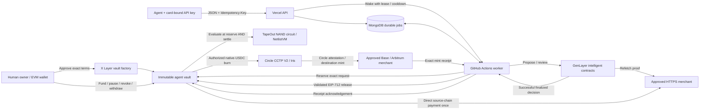
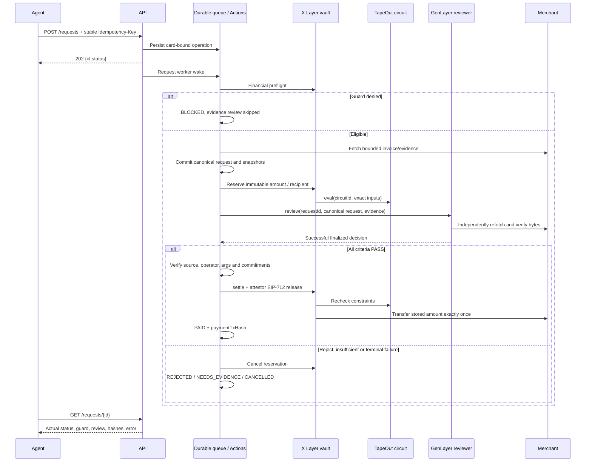
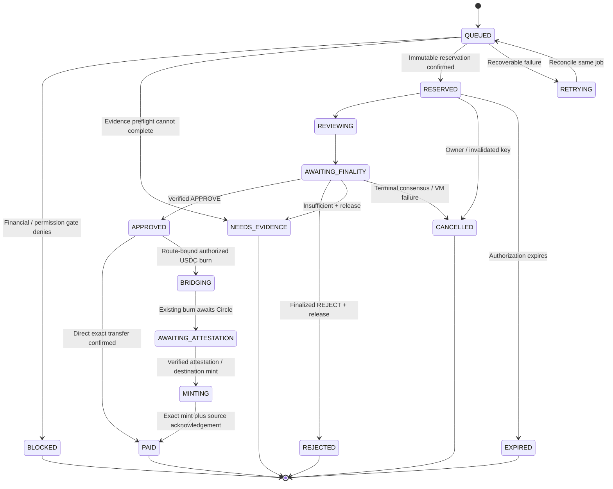
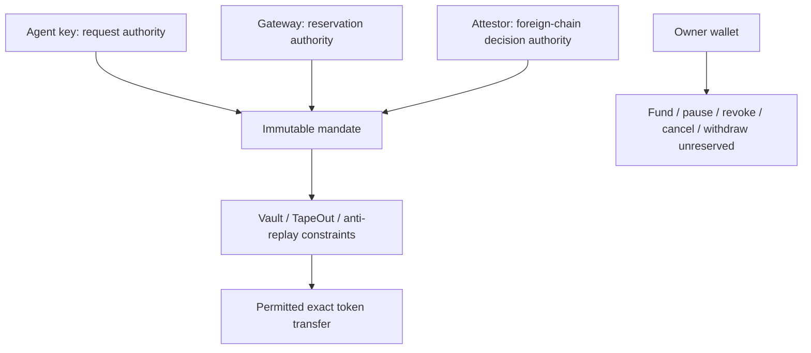

# IntentGuard

**An owner-approved spending protocol for autonomous agents.**

An agent gets a mission and a funded vault. Its API key can request a purchase, but funds move only when the immutable financial mandate and a finalized evidence decision both allow it. Native USDC cards keep source funding on X Layer and commit owner-approved destination networks; CCTP delivery is reconciled from its actual receipts. TapeOut is the mandatory numerical gate on X Layer; GenLayer reviews the purpose and proof; a durable Actions worker reconciles the two.

[Application](https://intentguard-tapeout.vercel.app/) · [Create agent](https://intentguard-tapeout.vercel.app/agent-setup) · [Explorer](https://intentguard-tapeout.vercel.app/explorer) · [Sectioned documentation](https://intentguard-tapeout.vercel.app/docs) · [Portable protocol manual](docs/PROTOCOL.md) · [OpenAPI](docs/openapi.json)

> Current release is **testnet only**: source vaults on X Layer 1952, native-USDC delivery on owner-approved Base Sepolia 84532/Arbitrum Sepolia 421614, and GenLayer Studionet 61999. Existing TEST-USDT agents are preserved. All testnet tokens have no monetary value. HTTP 202 admits an operation; a CCTP burn remains pending. **PAID confirms actual delivery.**

## Contents

- [The problem and the protocol](#the-problem-and-the-protocol)
- [System architecture](#system-architecture)
- [Payment lifecycle](#payment-lifecycle)
- [Financial invariants and TapeOut](#financial-invariants-and-tapeout)
- [GenLayer review and finality](#genlayer-review-and-finality)
- [Trust model](#trust-model)
- [Human onboarding](#human-onboarding)
- [Native USDC and cross-chain spending](#native-usdc-and-cross-chain-spending)
- [Agent integration](#agent-integration)
- [Evidence and invoice contract](#evidence-and-invoice-contract)
- [Errors, idempotency and recovery](#errors-idempotency-and-recovery)
- [Agent identity and public activity](#agent-identity-and-public-activity)
- [Skills and MCP](#skills-and-mcp)
- [Deployment and operations](#deployment-and-operations)
- [Development and verification](#development-and-verification)
- [Repository map](#repository-map)
- [Security and limitations](#security-and-limitations)

## The problem and the protocol

A wallet balance is not spending permission. A capable agent can misunderstand an amount, choose a disallowed product, accept a contradictory invoice or read an instruction embedded in evidence. Giving it an unrestricted wallet exposes the entire balance to those mistakes.

IntentGuard makes permission an explicit, immutable instrument:

| Layer | Responsibility | Can it authorize a transfer alone? |
|---|---|---|
| Human mandate | Name, mission, merchant recipients, evidence criteria, exact budgets and validity | Activation creates permission, not funding |
| TapeOut circuit | Exact payment/lifetime/period/time and permission constraints on X Layer | No |
| GenLayer contracts | Typed policy proposal and semantic evidence review | No |
| Attestor release | EIP-712 bridge of a verified GenLayer decision to the vault | Subject to the vault's constraints |
| Agent vault | Reservations, anti-replay, signature checks and exact ERC-20 settlement | Only the fully authorized stored request |
| GitHub Actions | Durable orchestration, receipts, finality and recovery | Uses configured gateway/attestor authority |

The product is an **IntentGuard ATM card** for one agent identity. It is a useful visual representation of the mandate and actual use, not a bank card, NFT or substitute for onchain authorization. Owners keep funding, pause, permanent revocation, cancellation, unreserved withdrawal and credential controls.

## System architecture



The frontend and API use Next.js on Vercel. MongoDB retains jobs, request/evidence commitments, hashed credentials, cancellation intent and transaction journals. Live signing happens in GitHub Actions. The web deployment has no worker signing keys.

Each vault commits one canonical policy hash and exact immutable onchain configuration. Each agent has a separate GenLayer reviewer initialized with that policy and the configured payment chain/token. Public transaction reasoning is independently verified from its finalized contract result before being displayed.

## Payment lifecycle





The diagram highlights normal paths; recovery can resume a previously reserved/reviewed operation from its persisted phase. It never creates a new purchase merely because a runner restarted.

Review stages are **PENDING, COMPLETE, SKIPPED, FAILED**. A budget denial has no semantic review to wait for. A failed GenLayer execution has no finalized reasoning to invent. Payment state and review stage are separate from the HTTP status of an API call.

## Financial invariants and TapeOut

TapeOut is part of the settlement path, not an optional dashboard calculation. The vault calls its configured processor for reservation and again immediately before transfer. A model approval cannot bypass a missing, changed or failing circuit.

The generated circuit has **451 inputs, 8 outputs, 1,766 NAND gates and zero state**. It evaluates seven little-endian uint64 fields and recipient/asset/enabled flags. Output bit 0 permits execution; the remaining bits report numerical/permission failures. Authorization expiry and additional ledger checks are also enforced in Solidity.

| Constraint | Enforcement |
|---|---|
| Per-payment maximum | Exact uint64 amount comparison |
| Lifetime budget | Paid + burned + reserved amounts consume capacity |
| Period budget | Pending reservations stay charged to their original period |
| Physical funds | Available token balance excludes other reservations |
| Validity and expiry | Onchain current time, policy window and request expiry |
| Merchant/asset/enabled | Immutable recipient/token and owner-controlled enabled state |
| Concurrent pending work | Maximum two outstanding reservations |
| Invoice replay | Recipient + invoice commitment blocks pending/paid reuse |
| Processor provenance | Bytecode, beacon implementation, netlist SHA256 and metadata pins |
| Transfer replay | Only RESERVED state can settle; stored amount/recipient used once |

Cancellation and expiry release an unpaid, unburned reservation. Paid and burned invoices remain committed; a CCTP burn cannot be cancelled, expired or repeated during recovery. Owner withdrawal is limited to unreserved balance and remains available independently of the numerical processor.

**Deployment provenance:** the live X Layer testnet uses `TESTNET_ADAPTER_UNMODIFIED_TAPEOUT_NETLIST_VM`, running TapeOut's unchanged NetlistVM with the generated circuit. This is TapeOut circuit execution and onchain data on X Layer. It is **not** a claim of using the official mainnet CPU registry or of hosting on X Layer DeWEB.

See [circuit generator and tests](circuits/), [vendor provenance](contracts/evm/src/vendor/README.md), [vault implementation](contracts/evm/src/AgentSpendingCard.sol) and [deployment pins/receipts](docs/deployments/testnet.json).

## GenLayer review and finality

IntentGuard uses intelligent contracts for two different tasks:

1. **Permission interpretation:** propose typed policy from human mission/guidance; validators assess fidelity to the original instructions. The human still reviews and activates the exact terms.
2. **Purchase review:** verify committed evidence against the immutable mission, approved merchants/products, exclusions/exceptions, freshness and every required criterion.

Sources are refetched and compared with their snapshots. PASS requires valid citations. One FAIL produces REJECT; INSUFFICIENT without FAIL produces NEEDS_EVIDENCE; only all PASS can produce APPROVE.

Approval requires successful **FINALIZED VM execution and consensus**, expected reviewer source/constructor/operator, exact target/method/arguments, and matching policy/request/evidence commitments. A broadcast hash, receipt, leader output or pending consensus is insufficient.

Native-USDC reviewers use version 3, adding immutable settlement and destination invoice checks. Existing version 2 and version 1 sources remain pinned. Version 2 reviewers use deterministic preflight. Deterministic permission failures and missing evidence are handled before model output, and validators independently reproduce those outcomes without an LLM. Semantic approval still requires independent model evaluation. Existing version 1 reviewers keep their pinned source; there is no silent migration.

GenLayer uses **Optimistic Democracy**, validators and possible appeals. Validator/model participation depends on the network and round. IntentGuard does not promise exactly five independent LLMs or claim that consensus makes hallucination impossible.

The [real 12-request audit](docs/AUDIT-12-FINDINGS.md) documents successful transfers, financial denials, evidence errors, anti-replay and two semantic cases that safely cancelled after consensus failure rather than producing the expected committed rejection. Keep these reliability limits visible until new live evidence demonstrates a correction.

The [follow-up verification](docs/AUDIT-12-FOLLOWUP.md) records wallet login recovery, actual usage cards, structured API errors, sectioned documentation, the cinematic story checks and the remaining reviewer/attestor limitations.

## Trust model



| Dependency / actor | What it is trusted for | Practical limit |
|---|---|---|
| Owner wallet | Choosing terms, recipients, criteria and signatures | Badly chosen permissions can allow bad purchases |
| Merchant sources | Evidence provenance and asserted invoice/product facts | Origin/hash cannot prove a dishonest claim |
| GenLayer consensus | Semantic reasoning and evidence validation | Model error, disagreement and finality delays remain possible |
| Attestor | GenLayer release and CCTP destination-receipt acknowledgement | X Layer does not independently verify foreign-chain consensus or mint receipts |
| Gateway | Reserving/cancelling permitted requests | Can delay or reserve capacity; cannot independently sign semantic release |
| MongoDB / Actions / RPC | Durable execution and receipt availability | Outages delay processing and require recovery |
| Pinned processor/circuit | Declared numerical predicate | Changes fail closed; pins are not a third-party audit |

A compromised attestor could attest false semantic approval within the vault's numeric, recipient, time and anti-replay boundaries. Agent keys do not control the owner's ordinary EOA assets. No module is described as a trustless bridge or an audited guarantee.

## Human onboarding

1. Connect an EVM wallet and sign the origin-bound login message.
2. Choose native USDC and permitted spending testnets; enter identity, mission, context, approved categories/merchants/evidence and exact budgets.
3. Propose the policy. Save the draft URL; pending jobs automatically request an Actions worker.
4. Read all finalized terms, chosen asset/spending networks and clarification questions. Activate only a successful PROPOSED policy you accept.
5. Confirm factory activation on X Layer Testnet. Registration verifies the confirmed event and immutable config.
6. Fund the vault with its actual native X Layer USDC token; native test OKB pays source gas. Legacy TEST-USDT agents retain their original token/faucet.
7. Wait for the per-agent reviewer to verify successfully. A terminal initialization failure has an owner-only retry preserving the same vault/policy.
8. Issue the one-time API key and store it securely. Download the ATM card or start the agent integration.

Budgets are immutable. Adding tokens does not increase lifetime permission. New terms require a replacement vault. API-key rotation/revocation and onchain pause/revocation are independent controls.

[Complete policy reference](https://intentguard-tapeout.vercel.app/docs/policy-fields) · [Activation](https://intentguard-tapeout.vercel.app/docs/proposal) · [Funding](https://intentguard-tapeout.vercel.app/docs/funding) · [Credentials](https://intentguard-tapeout.vercel.app/docs/credentials)

## Native USDC and cross-chain spending

**Owner deposit on X Layer → approved merchant delivery on selected testnets.** The agent's source vault remains on X Layer; the owner commits a nonempty allowed destination subset before activation.

| Testnet | EVM chain ID | CCTP domain | Native issuer USDC |
|---|---|---|---|
| X Layer | 1952 | 37 | `0xDec90b78111Ba2fc6FC6d84d8B9ec159A2d4b9B3` |
| Base Sepolia | 84532 | 6 | `0x036CbD53842c5426634e7929541eC2318f3dCF7e` |
| Arbitrum Sepolia | 421614 | 3 | `0x75faf114eafb1BDbe2F0316DF893fd58CE46AA4d` |

Runtime discovery publishes `assets`, `spendingNetworks` and `cctpFactoryAddress`. A null factory disables new USDC activation. Each card exposes its real `token`, `paymentSymbol` and `settlement`; legacy global token fields remain compatible with existing TEST-USDT vaults. Funding always uses the selected card's actual source token.

```json
{
  "settlement": {
    "asset": "USDC",
    "destinationChainIds": [1952, 84532, 421614]
  }
}
```

This is the optional field on owner draft submission; the owner may choose a smaller nonempty subset. Including1952 permits direct source-chain spending. Payment requests select an approved EVM `destinationChainId`, defaulting to source; domain 6/3 is not an EVM chain ID. Merchant invoice buyer remains the source vault, while invoice token/chain match destination USDC.

`CctpSpendingCard` reuses the required TapeOut guard and financial reservations, adds an immutable allowed-domain registry and route-bound EIP712 release, then calls Circle TokenMessengerV2. The V3 GenLayer reviewer validates destination invoices and settlement commitments. Standard CCTP uses finality 2000,maxFee=0 and no hooks; required source fees disable new burns until explicit fee-aware support exists.

The worker journals the source burn, fetches Circle's public Iris attestation, validates raw immutable fields, verifies the exact destination message plus native-USDC mint, and acknowledges a signed receipt on the source vault. `BRIDGING`, `AWAITING_ATTESTATION` and `MINTING` are nonterminal. `PAID` requires destination delivery plus source acknowledgement; `paymentTxHash` is the destination hash. The UI opens source burn, destination mint and source acknowledgement on their actual networks.

**After burn, cancellation/key revocation/pause/expiry cannot undo the transfer.** The original invoice and consumed budget stay committed. Outages, gas shortages or proof errors resume the same durable operation, never a second burn. A bounded wait expiring is not permission to create a new request. Source balances.spent includes pending burns; ATM fundsMoved counts only PAID delivery.

Circle verifies its attestation on destination contracts. IntentGuard's source vault trusts the configured receipt attestor for the foreign-chain mint acknowledgement; it does not independently verify that destination receipt. This trust boundary is separate from GenLayer approval trust.

**USDT0 remains disabled.** The supplied `0x779Ded0c9e1022225f8E0630b35a9b54bE713736` is an official X Layer mainnet chain 196 address and has no code on testnet 1952. No official testnet token/peer route was verified. Its LayerZero OFT route is distinct from native-USDC CCTP; no mocks or mainnet execution are substituted. USDT was removed from this phase.

[Complete cross-chain integration](docs/CROSSCHAIN.md) · [Issuer research](docs/STABLECOIN-RESEARCH.md) · [Machine-readable issuer proof](docs/deployments/stablecoins.json) · [Sectioned UI guide](https://intentguard-tapeout.vercel.app/docs/crosschain)

## Agent integration

The API selects the vault from the bearer key. An agent cannot pass another card or owner in payment input.

```ts
// From a repository checkout; the SDK is source, not a published npm package.
import {IntentGuard, IntentGuardError} from "./packages/sdk/index";

const guard = new IntentGuard(
  "https://intentguard-tapeout.vercel.app",
  process.env.INTENTGUARD_API_KEY!
);
const capabilities = await guard.capabilities();
const {card} = await guard.me();
// Read card.token and card.settlement.destinationChainIds.
// For cross-chain USDC, add destinationChainId and obtain its destination invoice.

// Replace each marked value with actual owner-approved merchant data.
const queued = await guard.request({
  recipient: "<APPROVED_MERCHANT_EVM_ADDRESS>",
  amount: "1.000001",
  purchaseDescription: "<ACTUAL_PURCHASE>",
  justification: "<HOW_IT_SERVES_THE_APPROVED_MISSION>",
  category: "<PERMITTED_CATEGORY>",
  invoiceId: "<FRESH_MERCHANT_INVOICE_ID>",
  evidence: [{url: "https://<APPROVED_HOST>/invoice.json"}]
}, "<STABLE_OPERATION_KEY>");

try {
  const result = await guard.wait(queued.id, {
    timeoutMs: 600_000,
    intervalMs: 5_000
  });
  if (result.status === "PAID") {
    console.log(result.paymentTxHash);
  } else {
    console.log(result.status, result.error, result.review);
  }
} catch (error) {
  if (error instanceof IntentGuardError) {
    console.log(error.code, error.status, error.requestId);
    // Preserve queued.id and the original operation key after timeout.
  }
}
```

Amounts are positive exact **decimal strings**, maximum six fractional places, converted to uint64 atomic units. One supported six-decimal token is 1,000,000 atomic units. Do not use floating point, exponent notation, negative amounts or JSON numeric amounts.

Core endpoints (relative to `/api/v1`):

| Method / path | Access | Result |
|---|---|---|
| GET /config | Public | Runtime chain/token/circuit/service configuration |
| GET /me | Agent | Credential-bound policy, reviewer and actual balances |
| POST /requests | Agent + Idempotency-Key | 202 durable operation ID and current state |
| GET /requests/{id} | Bound agent | Full current request, guard/review/hash/error fields |
| GET /explorer/agents | Public | Cursor-paginated deployed identities |
| GET /explorer/transactions | Public | Actual requests with status/agent filters |
| GET /explorer/transactions/{id} | Public | Detail, stage and verified finalized reasoning |
| GET /explorer/agents/{id}/card | Public | Identity plus measured usage snapshot |
| GET /explorer/agents/{id}/card.svg | Public | Standalone downloadable SVG |

Owner session endpoints and every request/response schema are in [OpenAPI](docs/openapi.json) and the [portable manual](docs/PROTOCOL.md).

## Evidence and invoice contract

A public invoice must name the **agent vault as buyer**, not the owner wallet. Its nine fields are:

```text
invoiceId, buyer, token, chainId, recipient,
amount, description, issuedAt, expiresAt
```

These fields must agree with the committed request and configured deployment. The invoice comes from an origin approved for that merchant recipient. Supporting evidence uses approved evidence origins. Invoice freshness, issue time and expiry use Unix seconds; UI/request creation timestamps use milliseconds.

Evidence retrieval permits bounded public HTTPS JSON/text, pins public DNS and rejects private/local destinations, redirects, credentials and non-text payloads. Each source is limited to 64 KiB; the bundle to 128 KiB. Optional SHA256 pins must match. Bytes must remain stable through GenLayer refetch.

Canonical JSON recursively sorts object keys, preserves array order and exact amount strings, and uses compact UTF-8. SHA256 commits policy, snapshots and canonical request. A finalized review and EIP-712 release bind those commitments to the stored request.

The legacy `/demo/invoices` route is a configured **reference merchant** for real testnet issuance using a separate administrator key. Agent keys cannot issue invoices. The route name does not cause sample records to appear in the product.

[Invoice schema](https://intentguard-tapeout.vercel.app/docs/invoice) · [Commitments](https://intentguard-tapeout.vercel.app/docs/snapshots)

## Errors, idempotency and recovery

```json
{
  "error": {
    "code": "IDEMPOTENCY_CONFLICT",
    "message": "This key was already used for different payment details",
    "retryable": false,
    "requestId": "<correlation-id>"
  }
}
```

Field validation can add `details[{field,code,message}]`. Every response has `X-Request-Id`; error responses are `no-store`. Rate-limited responses include `Retry-After`. Successful authenticated responses expose `RateLimit-Limit/Remaining/Reset/Policy`.

| HTTP | Meaning |
|---|---|
| 400 | Malformed/missing JSON |
| 401 | Missing, invalid, expired, rotated or revoked credential/session |
| 403 | Owner mutation from a denied origin |
| 404 | Unknown or inaccessible record/route |
| 405 | Recognized endpoint with wrong method; inspect Allow |
| 409 | Idempotency/policy/readiness/registration conflict |
| 413 | Payload too large |
| 415 | Required application/json Content-Type missing/wrong |
| 422 | Semantic input/amount/origin/schema failure |
| 429 | Fixed-minute quota exceeded; back off |
| 503 | Service/dependency unavailable or deployment not configured |

HTTP success is not a favorable review verdict. BLOCKED/REJECTED/NEEDS_EVIDENCE are normal asynchronous outcomes. No artificial 3xx redirects encode payment decisions.

Use one stable Idempotency-Key per business operation. Identical retries return its original ID; changed input returns 409. A new key represents a new attempted operation. The vault's invoice commitment separately prevents duplicate pending/paid invoices. On a lost POST response, retry identical input with the same key.

The SDK preserves structured errors and supports cancellable bounded polling. The MCP never silently retries payment admission. On timeout, retain the request ID and poll later. Do not endlessly retry an invalid schema, final rejection or failed evidence.

## Agent identity and public activity

The website displays **actual persisted usage only**. The landing page shows the latest three requests; public transaction and agent explorers link identity, numerical decision, evidence outcome and transfer. Empty and unavailable states are distinct.

Downloadable ATM cards include immutable identity, request/paid/blocked/rejected/evidence/cancelled/active counts, exact **fundsMoved from PAID records only**, chain/token and an as-of timestamp. HTTP idempotent retries do not inflate counts. Current balances remain separate from cumulative movement.

SVG is downloadable from the API; the UI also exports PNG and opens an X composer with the public identity URL. Attach the image manually. Cards contain no bearer key, cookie, private justification or invoice content. A shared card is a snapshot, not proof of solvency or spend authority.

The interface uses a distinctive engraved card/agent identity, sectioned docs, accessible scroll/entrance/micro/loading motion and an original rendered background film. Motion pauses offscreen, supports manual pause and respects reduced-motion preferences.

The [Why we exist story](https://intentguard-tapeout.vercel.app/why-we-exist) follows an original 3D agent and engraved ATM card through a six-act native-scroll camera journey: human mandate, TapeOut permission, GenLayer evidence, X Layer settlement and receipt. Pointer movement, opt-in ambient sound and transaction cues complement the scene. A blocked branch skips review and illustrates no transfer. The original 28-second film includes playback, sound, volume, replay and transcript controls. Graphics/media failures preserve the readable story with retry; reduced motion locks the scene and leaves film playback deliberate. Illustrations remain separate from actual explorer records.

## Skills and MCP

Install the repository skill:

```sh
npx skills add TS-mfon/intentguard --skill intentguard
```

It includes a portable protocol reference, so an agent does not need a docs link to learn setup and integration constraints.

Run the MCP server from a checkout:

```sh
npm ci --ignore-scripts --prefix packages/mcp
node packages/mcp/src/cli.mjs
```

Set `INTENTGUARD_BASE_URL` and `INTENTGUARD_API_KEY` through the client's secure environment. Node 22+ is required. The package is private/unpublished; do not assume `npx @intentguard/mcp` exists.

```json
{
  "mcpServers": {
    "intentguard": {
      "command": "node",
      "args": ["/absolute/path/intentguard/packages/mcp/src/cli.mjs"],
      "env": {
        "INTENTGUARD_BASE_URL": "https://intentguard-tapeout.vercel.app",
        "INTENTGUARD_API_KEY": "<OWNER_ISSUED_SECRET>"
      }
    }
  }
}
```

Keep secret-bearing configuration out of version control.

| MCP interface | Contents |
|---|---|
| Resources | `intentguard://protocol`, `intentguard://openapi` |
| Prompt | `payment_integration(task)` |
| Read tools | get_config, get_my_agent, get_payment, list_agents, list_transactions, get_transaction, get_agent_card |
| Bounded poll | wait_for_payment (maximum 45 seconds, same ID retained) |
| Mutation | submit_payment (strict payment input + stable idempotency key) |

MCP success returns `{ok:true,status,data}`; errors set `isError` with a structured machine code and retry guidance. Credentials stay in the server environment and are masked from results. Public tools do not send an Authorization header.

[Skill source](skills/intentguard/SKILL.md) · [MCP source](packages/mcp/) · [MCP setup docs](https://intentguard-tapeout.vercel.app/docs/mcp-skills) · [Agent resource index](apps/web/public/llms.txt)

## Deployment and operations

### Live worker model

[worker.yml](.github/workflows/worker.yml) runs 180-second bursts, serializes runs and retains a five-minute recovery schedule. The API wakes Actions after durable admissions and through pending reads. Trigger leases, cooldowns, heartbeat/deadline checks and continuation avoid unnecessary overlapping dispatch.

MongoDB's global worker lease is authoritative for signing. Job leases fence completion. Signed transaction bytes are persisted **before broadcast**; a restart rebroadcasts/reconciles the same transaction. Terminal consensus/VM failure stops indefinite finality polling and initiates reservation cancellation. Invalidated keys cancel unpaid/unburned work. Existing CCTP burns remain active for destination recovery.

The workflow refuses payment signing unless mode is testnet and chain is 1952. Runtime and runner startup still introduce latency; no instant/zero-delay promise is made.

```sh
gh run list --repo TS-mfon/intentguard --workflow worker.yml
gh run view <RUN_ID> --repo TS-mfon/intentguard --log
# Operator recovery after inspecting the durable queue:
gh workflow run worker.yml --repo TS-mfon/intentguard -f duration_seconds=180
```

Do not start a local signing worker alongside the hosted one. Local tests use isolated chains and fixtures.

The worker rotates fairly among proposal, reviewer and payment queues. Continuous finality or processing delays exceeding 30 minutes become `PROCESSING_TIMEOUT`: setup fails with recovery guidance, while unburned payments retain cancellation intent until the exact reservation release is confirmed. Existing CCTP burns stay active until delivery is reconciled; deadlines cannot cause a second burn.

### Configuration responsibilities

| Location | Required configuration |
|---|---|
| Vercel server | MongoDB URI/database, session secret, APP_URL, public contract/RPC pins, server-only Actions trigger credential |
| GitHub variables | Testnet mode/chain/token, RPCs, factory, gateway/attestor, TapeOut pins, interpreter, database, APP_URL |
| GitHub secrets | MONGODB_URI, XLAYER_OPERATOR_PRIVATE_KEY, REVIEW_ATTESTOR_PRIVATE_KEY, GENLAYER_OPERATOR_PRIVATE_KEY |
| Deployment operator | Dedicated deployer key for authorized testnet contract deployment |
| Agent/MCP client | Owner-issued agent key; application origin |
| Reference merchant | Separate administrator credential and approved recipient |

The USDC extension adds CCTP_CARD_FACTORY_ADDRESS and optional BASE_SEPOLIA_RPC_URL/ARBITRUM_SEPOLIA_RPC_URL. Destination relayer gas is funded separately. Use [.env.example](.env.example) for legacy names; set `INTENTGUARD_MODE=testnet`, `XLAYER_CHAIN_ID=1952`, the deployed TEST-USDT and testnet RPC for this release. Never copy its legacy live-mode defaults into the hosted testnet configuration.

**Origin migration:** the canonical application is `intentguard-tapeout.vercel.app`. Existing activated policies may approve the previous alias as an immutable merchant/evidence origin. Preserve that source compatibility rather than rewriting policy hashes. Changing APP_URL alone is not a policy migration.

### Deployed contracts

The authoritative [testnet manifest](docs/deployments/testnet.json) records chain IDs, addresses, code/netlist pins, source provenance and actual transaction hashes.

| Component | Current testnet address |
|---|---|
| TapeOut-compatible processor | `0xa34d101011d4dbe18375ff2e7591b646e22c2ff3` |
| Immutable beacon | `0x699f57090c5c74acc3b7f7f2fdc4f808ff6a010f` |
| TEST-USDT | `0x47f846c659b4df565d2e8b1cd32f610e68d11b9a` |
| Vault factory | `0xb452f9fabdf1599b2c72acbad0fc52baac58dfb7` |
| GenLayer interpreter | `0x0922B814Cd91a9f2fF36F95D321A74eA22CEa9d3` |

Per-agent vault/reviewer addresses are returned by the API and shown in the explorer. Always verify the runtime manifest; a table is documentation, not an RPC verification.

## Development and verification

Requirements: Node 24, pnpm 11.9.0; Foundry for EVM tests; Python/uv and GenLayer tools for contract tests. MCP uses its own pinned npm lock. The video composition has a separate Remotion package.

```sh
pnpm install --frozen-lockfile
pnpm dev
# http://localhost:3000; configure apps/web/.env.local or platform environment
```

The app shows real empty/error states when dependencies are absent. There is no sample-data mode to hide configuration problems.

```sh
pnpm typecheck
pnpm test
node tools/check.mjs evm
node tools/check.mjs circuit
node tools/check.mjs genlayer
node tools/check.mjs integration
node tools/check.mjs build
node tools/check.mjs browser
node tools/check.mjs release

npm ci --ignore-scripts --prefix packages/mcp
npm test --prefix packages/mcp
pnpm exec tsx scripts/verify-protocol-docs.ts
```

Verification scope:

| Check | Evidence |
|---|---|
| Core/API/worker tests | Auth isolation, schema bounds, idempotency, terminal recovery and state mapping |
| Circuit + EVM | Exact boundary predicate, reservations, replay, releases, rollover, owner controls, pins |
| GenLayer direct tests | Source validation, invoice/hash checks, criteria and finality safety |
| Integration | Isolated Anvil vault/token/signature/transfer behavior with test-only review fixtures |
| MCP stdio tests | Real MCP handshake/resources/tools against controlled HTTP, headers, strict input and no secret leakage |
| Browser | Responsive UI, real-data states, downloads, docs navigation and reduced motion |
| Hosted independent checks | Actual Vercel/API/chain records and GitHub worker behavior |

Fixtures exist only in tests, never as user activity. Passing local tests does not prove a live semantic outcome or guarantee external network availability. Published audit and deployment artifacts distinguish these evidence levels.

## Repository map

```text
apps/
  web/                 Next.js frontend, API and server adapters
  worker/              Durable Actions signing/recovery worker
  motion/              Original Remotion agent/ATM-card composition
packages/
  shared/              Strict policy/payment/review types and commitments
  sdk/                 TypeScript source client and structured errors
  mcp/                 Stdio MCP, bundled docs/schema and npm lock
contracts/
  evm/                 Vault, factory, testnet processor and TapeOut vendor sources
  genlayer/            Permission interpreter, purchase reviewer and direct tests
circuits/              NAND generator, artifact and independent tests
skills/intentguard/    Installable agent skill and portable protocol reference
docs/                  Protocol, deployment, operational and audit evidence
scripts/               Integration, browser, hosted and release checks
tests/                 Core/API/worker/protocol regression tests
.github/workflows/     Worker and verification automation
```

## Security and limitations

- This release handles testnet assets only and makes no third-party audit claim.
- Never commit private keys, MongoDB credentials, agent keys, session secrets, signed transaction bytes or secret-bearing MCP configuration.
- Owner policy/mission, addresses, amounts and finalized citations are public. Avoid personal/confidential information in published terms or merchant evidence.
- The attestor is an explicit foreign-chain trust boundary. TapeOut constrains quantities and permissions; it cannot decide whether a permitted purchase is wise.
- Merchant provenance and byte integrity do not establish objective truth.
- GenLayer consensus can disagree or fail. Safe cancellation protects funds but can still be an incorrect product outcome.
- Actions, database, Circle/Iris and RPC outages can delay work. Burned CCTP operations remain durable and cannot be cancelled or reburned during recovery.
- Source-vault budgets count burns before delivery; ATM fundsMoved counts only PAID delivery. Receipt attestor/RPC trust is explicit.
- USDT0 has no verified X Layer testnet deployment in issuer/RPC evidence. Mainnet addresses or fabricated replacements are not used.
- A downloaded ATM card is a snapshot; it is not proof of current solvency or a credential.
- Report vulnerabilities privately to the repository maintainer without including credentials or transaction-signing bytes in a public issue.

For precise integration behavior, use [PROTOCOL.md](docs/PROTOCOL.md) and [OpenAPI](docs/openapi.json). For measured behavior and unresolved findings, use [the 12-request audit](docs/AUDIT-12-FINDINGS.md) and [deployment artifacts](docs/deployments/).
