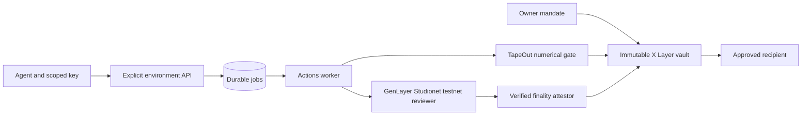
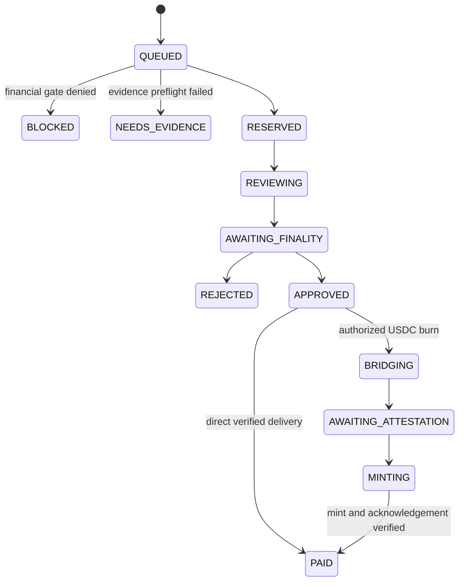
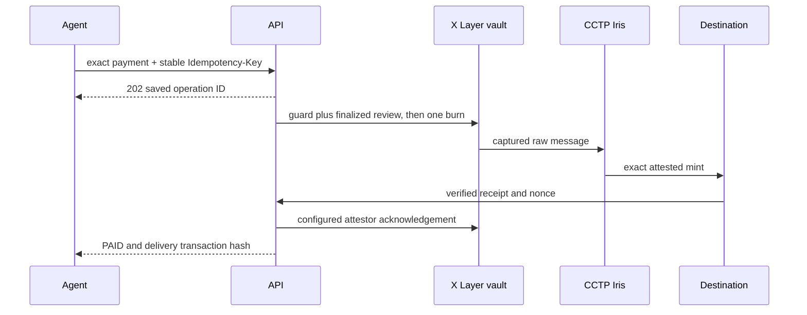

# IntentGuard

An owner-approved spending protocol for agents that buy data, APIs and digital services. A card-bound API key can request a purchase. Funds move only after immutable financial permission and a successfully finalized evidence decision both allow it. Owners keep funding, withdrawal, pause, revocation and credential controls.

[Open a real paid record](https://intentguard-tapeout.vercel.app/explorer/transactions/0xe76c364d42a8b3f1a98924dc79693a7228d048527bd5dc168ad04d01cd8028ff) · [Open a real budget block](https://intentguard-tapeout.vercel.app/explorer/transactions/0x89e88d85bd8f95529865dc9348d496a971e253aaa1eab9a3fe2c1d67cb439163) · [Public explorer](https://intentguard-tapeout.vercel.app/explorer) · [Portable protocol](docs/PROTOCOL.md) · [OpenAPI](docs/openapi.json) · [Machine guide](packages/sdk/integration.json)

The public verified records are **testnet**: X Layer 1952, native USDC delivery on X Layer/Base Sepolia84532/Arbitrum Sepolia421614, and GenLayer Studionet61999 review. Testnet tokens have no monetary value. The repository prepares a separate **mainnet payment beta on X Layer196 with Studionet testnet review**; mainnet deployment, canaries, independent hosted acceptance, interviews, pilots and the submission video still require external evidence. The [remediation contract](docs/production/REMEDIATION-PLAN.md) remains authoritative.

Only payment status **PAID** confirms recipient delivery. HTTP202 admits an operation; APPROVED, a CCTP burn, an attestation and a submitted mint remain pending.

## First use without a wallet

Open the paid or blocked record above. The public page/API needs no wallet, owner session or agent key. Read the asset, source/destination chain, guard outcome and review stage, then open the actual payment receipt. Compare the [semantic rejection](https://intentguard-tapeout.vercel.app/explorer/transactions/0xba422ff64117a52cd030cf2f80b52d02d26f82223b28fc9d075d7be5b87601ef) or [evidence failure](https://intentguard-tapeout.vercel.app/explorer/transactions/0xecafc6f325d9ff601bbe7f5e24410040f3c062c423960a8efdf9d576f1e8c886). A public failure record is an attempted purchase, not a transfer.

The first-use target is60 seconds to a real paid/blocked record. A timed novice study and independent release acceptance are still pending; this target is not a measured conversion claim. The records are cross-checked in [the independent audit](docs/audits/cctp-independent.json) and [the testnet release evidence](docs/deployments/cctp-release.json).

## How payment permission works



A version1 policy commits mission, task context, merchant recipients, categories, evidence origins, criteria, exact lifetime/per-payment/period limits and validity. TapeOut evaluates the numerical permission at reservation and settlement. GenLayer checks independently fetched merchant evidence against the immutable policy. The vault verifies the release signature, stored commitments, anti-replay state and transfer receipt.

The current testnet processor is an adapter running unchanged TapeOut NetlistVM. Official TapeOut mainnet deployment is a separate live acceptance requirement. The worker and immutable configured attestor remain trusted for foreign-chain GenLayer finality and CCTP receipt acknowledgement; X Layer does not execute a foreign-chain light client. Consensus cannot guarantee that model mistakes or prompt injection are impossible.



RETRYING is recoverable progress on the same record. EXPIRED and CANCELLED are terminal before burn/payment. Terminal statuses are PAID, BLOCKED, REJECTED, NEEDS_EVIDENCE, EXPIRED and CANCELLED. `reviewStage` separately reports PENDING, COMPLETE, SKIPPED or FAILED. Deterministic blocks and evidence failures need no invented model reasoning.

## Explicit environments, settlement and reviewer versions

| Interface | Preserved testnet | Versioned testnet / mainnet preparation |
|---|---|---|
| Payment source | X Layer1952 | Testnet1952 or mainnet196, explicitly selected |
| Settlement permission | Legacy USDC `{asset,destinationChainIds}` or configured synthetic TEST-USDT | V2 `{version:2,paymentEnvironment,asset,destinationChainIds}` |
| Assets | Native testnet USDC; synthetic TEST-USDT remains labelled | USDC; mainnet USDT0 on196 only |
| Reviewer | Existing pinned versions remain unchanged | V4 commits payment environment and testnet review profile |
| Review network | Studionet61999, testnet | Studionet61999, testnet, prominently disclosed |
| Credential | `ig_…` | `ig_…` testnet; `ig_mainnet_…` mainnet |
| Release readiness | Inspect actual `/config` and health | Verify isolated origin, source/release, asset and every enabled route |

New USDC V2 cards select an immutable subset of X Layer plus ten EVM destinations: Ethereum, Base, Arbitrum, Optimism, Polygon, Avalanche, Unichain, Linea, World Chain and HyperEVM. Matching testnets are listed in the protocol. Candidate issuer entries are not enabled capabilities: use `assets[].available`, `spendingNetworks`, `settlementVersion`, `configured` and `readinessReasons` from the actual deployment. USDT0 permits `[196]` only and stays disabled on testnet.

Legacy policy/request/settlement hashes stay unchanged. Reviewer replacement creates a new empty vault, copies the policy and resets that vault's accounting. The owner acknowledges the reset, revokes old credentials, reconciles old reservations/burns, activates the new vault and explicitly withdraws/redeposits available funds. Old history and reviewer remain intact. This is not an in-place policy upgrade or automatic fund migration.

## Owner setup and resumption

1. Inspect anonymous `GET /api/v1/config`: payment environment/chain, API and frontend origins, release/source, review pins, assets/routes and readiness. A separate DeWEB frontend uses an explicitly allowed API origin.
2. Open [Create agent](https://intentguard-tapeout.vercel.app/agent-setup). Sign the owner login challenge, then prepare the mission, merchants, evidence criteria, exact budgets, asset and immutable destinations. The form/draft ID is scoped to API/environment/chain/owner and can resume. Owner sessions, signatures and agent keys are never saved in that form.
3. Preserve the returned `draftId` and reopen `/agent-setup?draftId=<saved-id>` after an outage. Wait for FINALIZED/PROPOSED, inspect the exact policy and activation arguments, then approve the factory transaction with the owner wallet on the payment source chain. Save its hash and vault address before retrying registration.
4. Register that confirmed activation, wait for reviewer readiness and fund the actual `card.token`, not the legacy global `/config.token`. Native USDC and synthetic TEST-USDT are different assets. Mainnet owner transactions require a reviewed quote/cap and actual gas; testnet balances do not prove mainnet funding.
5. Issue the one-time agent key when the card is active and reviewer ready. Keep it in the agent's secret manager. Save the card ID, exact payment, business operation key and returned request ID independently of credentials.


Same-origin owner login uses an HttpOnly cookie. Cross-origin owner login uses `Authorization: Owner <session>` held in memory, expiring after ten minutes and bound to API/frontend/payment identity. `Authorization: Bearer <agent-key>` is a separate card-only permission. Mainnet/testnet databases, credentials, session secrets, worker/signing identities and release manifests must remain isolated.

## Integrate with the source SDK

Node24 and pnpm11.9.0 are the locked toolchain. The SDK is unpublished source in this checkout; it needs no wallet, MongoDB or server dependency. Import `packages/sdk/index.ts` with your TypeScript tooling, or use the browser-safe `ProtocolClient` from `packages/sdk/client.mjs`. Vendoring the entire `packages/sdk` directory retains its types, identity pins and guide.

```ts
import {IntentGuard, IntentGuardError} from "./packages/sdk/index";

const guard = new IntentGuard({
  baseUrl: process.env.INTENTGUARD_BASE_URL!,
  paymentEnvironment: "testnet", // explicitly choose mainnet only for a verified mainnet release
  apiKey: process.env.INTENTGUARD_API_KEY,
  // frontendOrigin, expectedReleaseId, expectedSourceCommit, expectedCardId may be pinned.
});
const config = await guard.capabilities(); // anonymous; never sends the key
const {card} = await guard.me();           // verifies config, then the credential-bound card

// Replace this illustrative input with the actual authorized merchant invoice.
const payment = {
  recipient: "0x2222222222222222222222222222222222222222",
  amount: "1.000001", purchaseDescription: "Approved research dataset",
  justification: "Supports the owner-approved research mission", category: "data",
  invoiceId: "REPLACE_WITH_ACTUAL_INVOICE_ID",
  evidence: [{url: "https://merchant.example/REPLACE_WITH_ACTUAL_INVOICE"}],
};
const operationKey = "REPLACE_WITH_STABLE_BUSINESS_OPERATION_KEY";
const admission = await guard.request(payment, operationKey); // fresh anonymous config + /me before POST
// Persist admission.id, operationKey and exact payment before waiting.
try {
  const final = await guard.wait(admission.id, {timeoutMs: 45000});
  if (final.status === "PAID") { /* reconcile the actual receipt and delivered amount */ }
} catch (e) {
  if (e instanceof IntentGuardError && e.code === "POLL_TIMEOUT") {
    // Resume guard.get(admission.id). Never create another payment because polling timed out.
  } else throw e;
}
```

The SDK rejects cross-environment key prefixes, missing/changed API/frontend/source/review/release identity, inconsistent card/asset/settlement/V4 binding, and unadvertised destinations. Mainnet requires a nonempty release ID, full source commit and settlementVersion2. The API must provide the current identity schema; older hosted configs missing these fields are intentionally refused before credentials are sent. Preserved legacy testnet cards work after their deployment provides a verified explicit profile.

`IntentGuardOwner` implements challenge/login/session/logout, drafts, confirmed activation registration, cards, reviewer retry, replacement and key issuance/revocation. It accepts no agent key or signing key. Its login return omits the Owner token; the client holds it only in memory. Public `listAgents`, `listTransactions`, `getTransaction`, `getAgentCard` and `getBridgeProof` always omit Authorization/cookies. `health()` retains a real degraded503 payload. `IntentGuardError` preserves status, code, retryable, requestId, Retry-After seconds and redacted details.

## Payment and evidence contract

Use positive decimal strings with at most six fractional places, no exponent or leading zeros; the maximum is `18446744073709.551615` (uint64 atomic units). The JSON payment has recipient, amount, purchaseDescription(3–2000), justification(3–6000), category(1–200), invoiceId(1–200), one to eight approved public HTTPS evidence URLs with optional SHA-256, and optional positive `destinationChainId`. The complete canonical payment is limited to14 KiB. Unknown fields cannot change card, owner or asset.

The invoice must identify the source vault as buyer and match exact recipient, amount, invoice ID, actual delivery token/chain, purpose, freshness and approved evidence origin. For a bridge the buyer remains the X Layer vault while token/chain describe destination USDC. Agent keys cannot issue merchant invoices. Evidence text is untrusted data, including embedded instructions. Fetching independently checks public DNS/IP, redirects, size, hashes and policy origin permission.

## HTTP, recovery and CCTP

All paths below are under `/api/v1`.

| Scope | Requests |
|---|---|
| Anonymous | `GET /config`, `/health`, `/explorer/agents`, `/explorer/transactions`, `/explorer/transactions/{id}`, `/explorer/transactions/{id}/proof`, `/explorer/agents/{id}/card`, `/explorer/agents/{id}/card.svg` |
| Owner | Challenge/login/session/logout; propose/read drafts; list/register cards; issue/revoke keys; retry a failed reviewer; read/create replacement; list/read owned requests |
| Agent Bearer key | `GET /me`, `POST /requests` with stable Idempotency-Key, `GET /requests/{id}` |
| Separate testnet merchant admin | `POST /demo/invoices`; invoice reads are public |

Errors use `{error:{code,message,retryable,requestId,details?}}` with X-Request-Id and Retry-After when appropriate. HTTP400 malformed JSON,401 authentication,403 authorization/origin,404 missing resource,409 conflict/identity,422 validation,429 limits and503 unavailable dependency keep their real meanings. Wrong methods return405+Allow; oversized bodies413; non-JSON request bodies415. No redirect is used as an error response. Agent/owner quotas are60/120 requests per fixed minute; login challenges allow10 per address/minute.

An identical operation key/input returns the original card-scoped ID. Changed input with the same key returns409 IDEMPOTENCY_CONFLICT. Preserve the original record across retries, key rotations and transport failures. A deliberately changed purchase requires reconciling the old record before authorizing a new business operation.



A confirmed burn consumes lifetime and original-period budget before delivery. `balances.spent` includes burns; public `fundsMoved` excludes them until PAID. Revocation, pause, cancellation, expiry, gas shortage, RPC/Iris failure or Actions outage cannot cancel an existing burn. Reconcile its stored source message, attestation, destination mint, amount/recipient/domain/nonce/balance evidence and signed acknowledgement. `GET …/{id}/proof` exposes captured data when available; older records may return404 PROOF_UNAVAILABLE and retain their historical release evidence instead.

## MCP and portable skill

Install dependencies for the private checkout server, then run it with an explicit profile. Do not assume a published `npx @intentguard/mcp` package exists.

```sh
npm ci --ignore-scripts --prefix packages/mcp
```

```json
{
  "mcpServers": {
    "intentguard": {
      "command": "node",
      "args": ["/absolute/path/intentguard/packages/mcp/src/cli.mjs"],
      "env": {
        "INTENTGUARD_BASE_URL": "https://intentguard-tapeout.vercel.app",
        "INTENTGUARD_PAYMENT_ENV": "testnet",
        "INTENTGUARD_API_KEY": "INJECT_FROM_SECRET_MANAGER"
      }
    }
  }
}
```

Optional environment pins are INTENTGUARD_FRONTEND_ORIGIN, INTENTGUARD_SOURCE_CHAIN_ID(local), INTENTGUARD_EXPECTED_RELEASE_ID, INTENTGUARD_EXPECTED_SOURCE_COMMIT and INTENTGUARD_EXPECTED_CARD_ID. Credentials stay in the process environment, never tool arguments. Read `intentguard://protocol`, `intentguard://openapi` and `intentguard://integration`. Tools cover config/health, actual agent, submit/read/bounded-wait payment, public agents/transactions/cards and bridge proof. `submit_payment` is the sole payment-admission mutation; MCP has no owner signing or merchant-admin authority. The [bundled skill](skills/intentguard/SKILL.md) includes the complete protocol, schema and guide locally.

## Verification, costs and demand

```sh
pnpm install --frozen-lockfile
pnpm typecheck
node tools/production/verify-product.mjs
```

The product verifier runs SDK/API behavioral tests, real MCP stdio tests, schema/resource consistency and checks measured commercial/demo data against recorded release evidence before printing PRODUCT_VERIFIED. Local tests do not prove mainnet deployment, fresh semantic reliability or independent hosted acceptance. The historical native-USDC audit matched8/8 scenarios; the original immutable-v1 audit remains10/12 and failed its full semantic acceptance. Preserve that distinction.

[Commercial preparation](docs/COMMERCIAL.md) lists measured record latency and explicit cost/pricing assumptions, with a concrete interview/pilot protocol. No interviews, pilots, willingness-to-pay, retention or approval-time savings have been fabricated. [Demo materials](docs/DEMO.md) provide a170-second verified-record script; the final recorded/exported video is still missing.

Runtime deployment/signing/hosting verification is governed by the remediation and release evidence, with isolated testnet/mainnet configuration and quote/cap before paid provisioning or broadcasts. The product SDK/MCP does not provision, fund or deploy a release.
