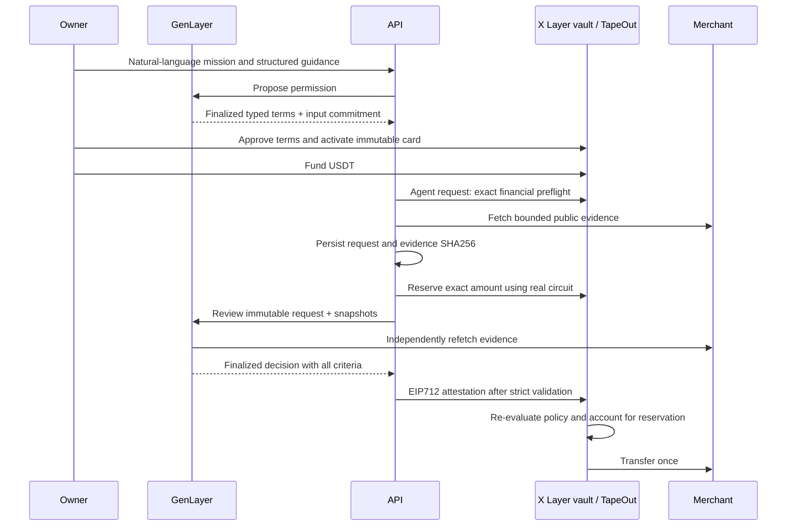

# Payment authorization

Each card has one immutable JSON policy, an onchain SHA256 policy commitment and a separate immutable GenLayer reviewer. The owner approves proposed terms through factory activation. The API verifies the actual factory event and every config field before registering a card.

Credentials are random, card-bound API keys stored as hashes. Wallet sessions use a single-use signed challenge and an HttpOnly HMAC cookie. Owner writes require the configured application origin; request reads enforce owner/card isolation.

MongoDB stores jobs, immutable request/evidence snapshots, keys, short-lived rate slots and signed transaction records. A durable global worker lease serializes signing nonces across replicas. Individual job leases fence completion. A raw transaction is persisted before broadcast, so recovery resends the same transaction. Onchain request state provides an independent reconciliation source.

Financial preflight happens before evidence retrieval. Evidence capture pins public DNS resolution, rejects private addresses, credentials, redirects and non-text data, and enforces size and hash bounds. A matching current merchant invoice determines the authorization expiry, capped by the card lifetime and 24 hours.

A reservation consumes the funded balance, lifetime and original-period budget. There can be at most two pending reservations. Canceled or expired requests release capacity; paid invoices cannot replay. Rollover retains the original period assignment. The contract rechecks the policy immediately before transfer.

GenLayer is used for both interpretation and every evidence judgment. A review must be FINALIZED, successful in the VM, consensus-approved, targeted at the expected reviewer by the expected operator, and bound to the exact method, arguments, policy, request and evidence. Only complete PASS criteria allow a release.

The attestor bridges the GenLayer result to X Layer. The X Layer contract verifies its signature, not GenLayer consensus. A compromised attestor can attest falsely within the vault's financial and merchant restrictions. A compromised gateway can reserve permitted funds and delay work but cannot independently authorize semantic release. API key holders cannot withdraw or control the owner's wallet. Protocol beacon/code/netlist pins fail closed after an upgrade; owners can withdraw unreserved balances independently.

Public merchant evidence provides origin and integrity checks. It does not establish the truth of claims outside those sources. Use merchants whose invoice and product claims the owner is willing to trust.
