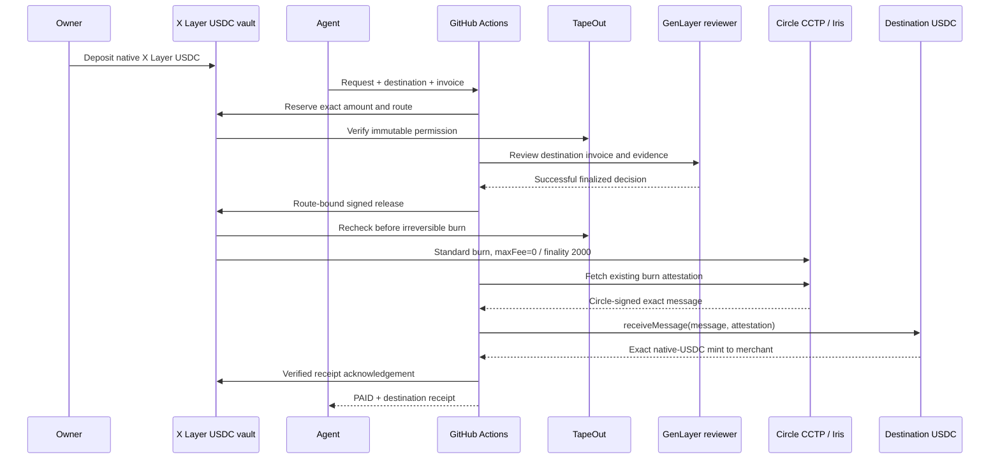

# Native USDC and cross-chain spending

The owner funding flow is **X Layer deposit → merchant spending on approved testnets**. These are the complete supported native-USDC routes:

| Testnet | EVM chain ID | CCTP domain | Native USDC |
|---|---|---|---|
| X Layer | 1952 | 37 | `0xDec90b78111Ba2fc6FC6d84d8B9ec159A2d4b9B3` |
| Base Sepolia | 84532 | 6 | `0x036CbD53842c5426634e7929541eC2318f3dCF7e` |
| Arbitrum Sepolia | 421614 | 3 | `0x75faf114eafb1BDbe2F0316DF893fd58CE46AA4d` |

All three tokens are native issuer-deployed testnet USDC with six decimals and no monetary value. A CCTP domain is distinct from the EVM chain ID sent to the API. This release supports this allowlist; it does not advertise arbitrary networks.

**USDT0 is disabled:** the supplied `0x779Ded0c9e1022225f8E0630b35a9b54bE713736` is the issuer's X Layer mainnet chain 196 deployment and returned no code on chain 1952. The official testnet deployment API returned no entry. Enabling it requires an official testnet token, test-token source and supported peer registration. USDT0's LayerZero OFT path is separate from native-USDC CCTP; no testnet registration is inferred or mocked. USDT was removed from this phase.

GET /config publishes assets (asset,symbol,chainId,decimals,token,available,reason,sources), spendingNetworks (chainId,name,domain,token,explorerUrl) and cctpFactoryAddress. A null factory means native-USDC activation is unavailable even if issuer routes are verified. Legacy config.token/paymentSymbol remain TEST-USDT compatibility fields. Use /me.card.token/paymentSymbol/chainId/settlement to identify the actual agent asset. Existing TEST-USDT agents keep their original immutable token, factory and reviewer; no silent migration occurs.

New draft input adds settlement={"asset":"USDC","destinationChainIds":[1952,84532,421614]}. The subset must be nonempty, unique and limited to those IDs; the server sorts it before commitment. Include1952 to permit direct X Layer spending. The human reviews this selection alongside the finalized policy. Activation.kind=CCTP_V2 selects the new factory and destinationDomains37/6/3. The API verifies the actual factory/token/allowed domains; the V3 GenLayer reviewer verifies the immutable settlement hash and request destination. Omitted settlement preserves legacy drafts.

Fund the vault using its actual native source token, after obtaining X Layer testnet USDC from an issuer faucet or existing balance. Do not call the TEST-USDT mint function on an issuer token. Circle's public faucet is https://faucet.circle.com; the user-provided native-gas faucet is https://web3.okx.com/xlayer/faucet/xlayerfaucet. If a faucet only offers another supported testnet, use a documented issuer route and independently verify source arrival before funding. Source USDC and native test OKB gas are independent of destination relayer gas. Deposits cannot increase immutable spending permission.

PaymentInput adds optional destinationChainId; it defaults to the card's source chain. For Base send84532, for Arbitrum421614, never domain 6/3. Read the approved subset from /me and destination token from spendingNetworks. A legacy agent permits only its source chain. Unsupported or unapproved destinations fail before durable admission (HTTP 422 DESTINATION_NOT_ALLOWED). Invoice buyer remains the source vault; invoice.chainId/token match destination USDC.

The reference merchant administrator may issue {buyer,amount,description,chainId,token}. Provide chainId+token together; a partial pair yields422 INVOICE_ASSET_REQUIRED, a nonofficial pair yields ASSET_OR_ROUTE_UNSUPPORTED. Agent keys cannot issue invoices. All ordinary approved-origin, invoice-ID, exact amount, freshness, description and stable evidence constraints continue to apply.

Example SDK integration using real owner-approved values:

```ts
const capabilities = await ig.capabilities();
const { card } = await ig.me();
const destinationChainId = 84532; // Only if the owner approved Base Sepolia.
const network = capabilities.spendingNetworks.find(n => n.chainId === destinationChainId);
if (!network || !card.settlement?.destinationChainIds.includes(destinationChainId))
  throw new Error("Owner did not approve this route");
// Obtain a real merchant invoice with:
// buyer=card.address, chainId=destinationChainId, token=network.token.
const queued = await ig.request({
  destinationChainId,
  recipient: "<APPROVED_MERCHANT_ADDRESS>",
  amount: "<EXACT_POSITIVE_DECIMAL>",
  purchaseDescription: "<ACTUAL_DELIVERABLE>",
  justification: "<MISSION_FIT>",
  category: "<PERMITTED_CATEGORY>",
  invoiceId: "<FRESH_MERCHANT_INVOICE_ID>",
  evidence: [{url: "https://<APPROVED_HOST>/invoice.json"}]
}, "<STABLE_OPERATION_KEY>");
```

TapeOut reservation and settlement checks, committed public evidence and a successful finalized GenLayer approval precede a CCTP source burn. The signed release binds destination, merchant, amount and exact message route to policy/request/evidence/decision. Standard transfer uses minFinalityThreshold=2000,maxFee=0,destinationCaller=0 and no hook data. Fees are never silently subtracted: a required source fee change disables new burns until explicit fee-aware support exists.

The source vault burns USDC through official Circle TokenMessengerV2. Source MessageSent plus BridgeStarted events are verified. Iris V2 GET https://iris-api-sandbox.circle.com/v2/messages/37?transactionHash=<sourceHash> supplies public attestations without an API key. The worker validates raw bytes and immutable fields against the source receipt. Iris fills nonce and executed-finality fields offchain, so full source/attested byte equality is incorrect. Source hash, domains, both messengers, source token, vault, merchant, amount, fees, finality and hook constraints remain bound.

Destination MessageTransmitterV2 verifies Circle's signature. The worker independently verifies the exact consumed nonce/message and native-USDC mint to the approved merchant. A transaction hash or success receipt without these matching events is not sufficient. The source vault's receipt acknowledgement is a separate transaction.

RequestView.bridge contains protocol=CCTP_V2,phase(BURNED,ATTESTATION_PENDING,ATTESTED,MINT_SUBMITTED,CONFIRMED),sourceChainId,destinationChainId,destinationDomain,sourceToken,destinationToken,amount,sourceTxHash,updatedAt and optional messageHash,nonce,destinationTxHash,confirmationTxHash. The object is absent before verified source burn. APPROVED,BRIDGING,AWAITING_ATTESTATION and MINTING are nonterminal. **PAID requires verified destination mint plus source-vault acknowledgement.** For CCTP paymentTxHash is the destination receipt; source burn/acknowledgement remain separate in bridge. Open each hash on its actual chain.

A confirmed burn consumes lifetime and original-period spending permission before merchant delivery. balances.spent includes burned amounts; downloadable fundsMoved excludes pending delivery. An existing burn cannot be cancelled, expired, refunded or repeated through owner/key controls. Key revocation, pause/revoke, cancellation intent, gas shortage, RPC/Iris errors and Actions interruptions keep its reconciliation durable. Signed source/destination transactions are saved before broadcast; nonce consumption and receipts are reconciled without a second burn. The original invoice remains committed.

Native-USDC card EIP712 domain version 2 distinguishes it from legacy domain version 1. BridgeRelease adds routeHash=keccak256(abi.encode(uint32 destinationDomain,bytes32 mintRecipient,uint64 amount,uint256 maxFee=0,uint32 finality 2000,bytes32 destinationCaller=0)). BridgeReceipt binds requestId,requestHash,routeHash,sourceTxHash,destinationTxHash,messageHash,amount. Direct payments on the new card retain the Release field shape with domain version 2.

The source vault verifies the receipt-attestor signature. **X Layer does not independently verify foreign-chain receipt consensus.** Circle's destination attestation verification and IntentGuard's receipt-attestor/RPC trust are distinct boundaries; a compromised receipt attestor can falsely acknowledge delivery within the immutable route commitments.

Asynchronous codes such as CCTP_ATTESTATION_UNAVAILABLE,CCTP_RATE_LIMIT,DESTINATION_GAS_REQUIRED,BRIDGE_COMMITMENT_MISMATCH and BRIDGE_RECEIPT_UNAVAILABLE are exposed in errorCode. Technical mismatch may require operator investigation of the same operation, never a replacement burn. Standard finality plus Actions scheduling can take minutes. Preserve the existing ID and Idempotency-Key if bounded SDK/MCP polling ends first; timeout is not cancellation or permission to create another payment.

## Settlement sequence



## Delivery state and receipt checklist

| Status | Receipt evidence | Action |
|---|---|---|
| APPROVED | Finalized GenLayer result; no delivery yet | Poll existing ID |
| BRIDGING | Authorized source burn | Inspect source hash; never reburn |
| AWAITING_ATTESTATION | Existing burn awaiting Circle standard finality | Worker retains durable backoff |
| MINTING | Attestation/mint discovery/source acknowledgement | Inspect destination/source hashes |
| PAID | Exact destination mint and source acknowledgement | Record destination paymentTxHash |

Source and destination signing live only in GitHub Actions. The database saves raw signed bytes before broadcast. Interrupted runs reconcile the same journal; a burned request is never resubmitted as a new business operation because a worker went offline. Missing gas or unavailable attestation exposes a real pending phase/error rather than fake delivery. The UI shows the actual source burn, destination mint and acknowledgement links on their respective networks.

## Verified proof and operating references

[Issuer research](STABLECOIN-RESEARCH.md) and [public proof](deployments/stablecoins.json) document official contracts, deployed code, decimals, domains, messenger/minter/transmitter relations, remote mappings and measured balances. Those deployment/funding balances are operator evidence, not agent usage. The [protocol manual](PROTOCOL.md) and [OpenAPI](openapi.json) define complete policy, auth, request and error formats; both are bundled with the MCP and skill.

This native-USDC release does not claim verified USDT0 support. Mainnet addresses and mocks are excluded from testnet asset registration. A green local build does not prove live destination delivery; release proof must identify the real source burn, attestation, destination mint and source acknowledgement.
