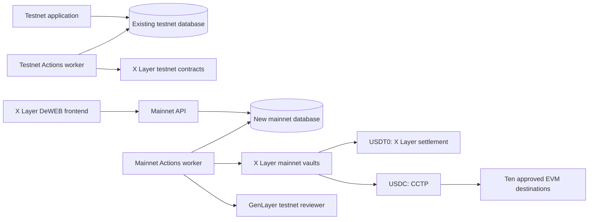

# IntentGuard: remediation, dual deployments, and mainnet beta

## 1. Agreed direction and current baseline

Maintain two separate environments:

| Component | Current testnet | New mainnet beta |
|---|---|---|
| Payment source | X Layer testnet, 1952 | X Layer mainnet, 196 |
| Assets | Native testnet USDC; existing synthetic cards remain labelled | Native USDC and USDT0 |
| Cross-chain spending | Expand and validate matching testnet routes | USDC through CCTP to ten EVM networks |
| USDT0 spending | Disabled until an official testnet deployment exists | X Layer settlement only |
| Semantic review | Existing versioned GenLayer reviewers | GenLayer Studionet (61999) review, prominently disclosed |
| Database | Preserve existing database | Create `intentguard_mainnet` with separate credentials |
| Execution | GitHub Actions | GitHub Actions until a VPS is affordable |
| Frontend | Preserve current Vercel application | Publish through X Layer DeWEB/TapeKit |
| Spending policy | Testnet execution | Prepare quotes before paid provisioning or broadcasts |

Your clarification establishes a **mainnet payment beta with GenLayer Studionet testnet review**. Payment receipts and financial data will be mainnet; the review network will remain explicitly identified as testnet.

The plan starts from commit `63ecc77`. Its [GitHub validation run passed](https://github.com/TS-mfon/intentguard/actions/runs/40263168673). The latest evidence records 8/8 native-USDC scenarios, including prohibited-purchase rejection. The original 12-case audit remains 10/12; general prompt-injection reliability and legacy reviewer replacement remain outstanding.

Two criticisms need qualification:

- Strict parsing found no duplicate keys in the current 12 deployment JSON files. Schema clarity and duplicate-key regression checks still belong in the plan.
- The canonical application responded successfully during this inspection. Three independent availability checks are still required.

[TapeKit’s implementation](https://github.com/TapeOutProtocol/TapeKit/tree/37c617e7e332787c8a32a81e4d7d05a28a06c156) supports X Layer hosting. Read-only mainnet checks found deployed code at the published TapeOut factory, site registry, native-USDC contract, and USDT0 contract. These checks establish feasibility; deployment verification must additionally inspect implementations, ownership, fees, and behavior.

## 2. Architecture and public interfaces

### Networks

The ten destinations beyond X Layer are fixed as follows. Owners select an immutable subset for each USDC card.

| Destination | Mainnet chain ID | Matching testnet chain ID | CCTP domain |
|---|---:|---:|---:|
| Base | 8453 | 84532 | 6 |
| Arbitrum | 42161 | 421614 | 3 |
| Optimism | 10 | 11155420 | 2 |
| Ethereum | 1 | 11155111 | 0 |
| Polygon | 137 | 80002 | 7 |
| Avalanche | 43114 | 43113 | 1 |
| Unichain | 130 | 1301 | 10 |
| Linea | 59144 | 59141 | 11 |
| World Chain | 480 | 4801 | 14 |
| HyperEVM | 999 | 998 | 19 |

Verify every route against official issuer documentation and live RPC state before enabling it. Chain IDs and CCTP domains remain separate identifiers.

### Environment and contract separation

- Require an explicit payment environment. Remove ambiguous hosted defaults that could combine mainnet payment settings with an unintended reviewer or database.
- Separate origins, session secrets, agent credentials, operator keys, attestor keys, deployment journals, worker concurrency groups, and release manifests.
- Store and verify deployment identity in each database. A worker must refuse a database or contract belonging to the other environment.
- Give each card one immutable asset. USDC cards may allow local and CCTP settlement; USDT0 cards allow X Layer settlement only. Funding uses the card’s actual token.
- Deploy new mainnet contract versions with verified immutable token, messenger, domain, route, processor, and signature configuration. Preserve existing testnet contracts.
- Use a versioned reviewer that binds the mainnet payment chain, token, policy, request, evidence, and destination permission despite running on GenLayer testnet.
- Target verified Studionet testnet for the new reviewer. Pin its network identity, including chain61999, the simulator genesis response and the SDK consensus address. Studionet currently returns a zero genesis hash and no EVM bytecode at that address; these pins are configuration checks, not proof of a deployed EVM consensus contract. If unavailable, leave spending disabled; do not silently substitute another network.

### API, SDK, and MCP changes

- Extend configuration with payment environment, review environment/network, release identity, verified assets, destination capabilities, and readiness reasons.
- Add `/api/v1/health`, exposing release identity, public dependency status, and worker freshness without credentials.
- Version the settlement schema for USDC routes and USDT0 local settlement. Preserve existing policy and request commitment formats for legacy cards.
- Add environment-aware proof and transaction responses. SDK/MCP clients verify the configured environment before submitting credentials or payment requests.
- Support the DeWEB frontend through an explicit API-origin allowlist. Use short-lived, origin-bound owner bearer sessions held in memory for cross-origin access, avoiding reliance on third-party cookies. Preserve the existing testnet cookie flow.
- Keep stable error codes and appropriate HTTP semantics: malformed input `400`, authentication `401`, authorization `403`, missing resources `404`, conflicts `409`, policy/input validation `422`, limits `429`, and unavailable dependencies `503`. Use `303` only for an actual redirect.

## 3. Detailed remediation checklist

Every row becomes a finding or deliverable with an owner, dependencies, an observable gate, and linked evidence. All new checklist items begin unchecked.

| ID | Priority | To do | Acceptance evidence |
|---|---|---|---|
| R01 | P0 | Archive the supplied reviews verbatim, including scores, corrections, allegations, recommendations, and qualifications. | Original text comparison and SHA-256; no reconstructed summary presented as the original. |
| R02 | P0 | Reconcile every criticism against current source and evidence. | Each source finding maps to a stable ID classified as confirmed, historical, partially resolved, unverified, or externally dependent. |
| R03 | P0 | Establish one release identity per environment. | Immutable source tag → lock/toolchain hashes → build → circuit/vendor/reviewer hashes → contracts → deployment → audits. |
| R04 | P0 | Make canonical origins and availability authoritative. | Health identity matches deployment; DNS, HTTPS, browser, and core routes pass from three independent environments. |
| R05 | P1 | Standardize manifests and validate raw JSON before parsing. | Addresses, transaction hashes, and code hashes are unambiguous; a deliberately duplicated key fails validation. |
| R06 | P0 | Repair clean-install and Docker execution. | Exact locked toolchain installs in a clean environment; web target serves HTTP; worker target processes its queue. |
| R07 | P0 | Harden GitHub Actions reproducibility and secrets access. | Actions pinned to commit SHAs; tool versions pinned; minimal permissions; untrusted PR jobs cannot access execution secrets. |
| R08 | P0 | Implement strict environment isolation throughout API, contracts, scripts, SDK, and workers. | Cross-environment credentials, databases, receipts, routes, and signing operations are rejected. |
| R09 | P0 | Create the new mainnet database and least-privilege principals. | Empty initial database, verified indexes, bounded connection behavior, denied testnet access, and successful backup/restore exercise. |
| R10 | P0 | Verify both mainnet assets and all ten CCTP routes. | Issuer provenance, chain identity, code/implementation hashes, decimals, messenger relationships, domains, pauses, fees, and route mappings. |
| R11 | P0 | Complete reviewer preflight, citation, commitment, and network handling. | Deterministic failures avoid model generation; validators independently verify results; malformed/finally failed receipts cannot authorize payment. |
| R12 | P0 | Provide explicit replacement for legacy reviewers. | Owner creates a replacement card, verifies policy/reviewer, rotates credentials, and withdraws/redeposits available funds; pending reservations and old history remain intact. |
| R13 | P0 | Run fresh adversarial semantic and reliability audits. | Two independent runs with fresh evidence, expected finalized outcomes, public receipts, and declared latency/failure thresholds. |
| R14 | P0 | Eliminate unexplained stuck execution states. | Durable wake, retry, lease recovery, cancellation, and progress reporting pass crash/outage tests; terminal states stop showing pending review. |
| R15 | P0 | Complete CCTP receipt proof and reconciliation. | Source burn, raw message, Iris response, destination mint, amount/recipient/domain checks, balance evidence, nonce consumption, and signed acknowledgement. |
| R16 | P0 | Test and document attestor compromise and operational controls. | Forged/mismatched acknowledgements fail worker verification; signature replay fails; rotation and emergency pause are exercised; remaining trust is explicit. |
| R17 | P0 | Perform the adversarial security audit, repair defects, and retest. | Reproductions, regression tests, fix commits, deployed verification, and a final scoped report with no unresolved confirmed security defects. |
| R18 | P0 | Deploy the circuit through official TapeOut mainnet infrastructure. | CPU/circuit identifiers, transaction receipts, processor and beacon pins, vendor provenance, and independently reproduced live vectors. |
| R19 | P1 | Publish the frontend through X Layer DeWEB. | Verified container/name, file hashes, resumed chunk uploads, working routes, wallet login, API permissions, and gateway compatibility. |
| R20 | P1 | Preserve and verify existing product features. | Real latest-three transactions, accurate downloads, unique icon/logo, wallet login, explorer, sectioned docs, story animation/audio, and reduced-motion behavior. |
| R21 | P1 | Synchronize protocol documentation and agent tooling. | README, OpenAPI, SDK, MCP resources, skills, and machine-readable guides agree and support integration without a separate docs link. |
| R22 | P1 | Sharpen positioning and first-use flow. | A visitor reaches a real paid or blocked record within 60 seconds without connecting a wallet; setup remains resumable. |
| R23 | P1 | Publish measured operating costs and explicit pricing hypotheses. | Review, RPC, Actions, database, gas, support, and hosting costs traced to measurements or clearly labelled assumptions. |
| R24 | P1 | Validate demand and recurring value. | Actual interviews/pilots, willingness-to-pay responses, repeat requests, retention, approval time saved, and false-positive/negative measurements. |
| R25 | P1 | Produce the submission demo from verified records. | Video ≤3 minutes; every displayed payment, block, rejection, evidence failure, and replay maps to public release evidence. |
| R26 | P0 | Deploy and verify the mainnet beta. | Reviewed deployment quote, authorized spending cap, verified bytecode/configuration, real limited canaries, and isolated mainnet records. |
| R27 | P0 | Reverify the complete release and findings register. | Every required gate has current evidence or an explicit handoff; both environments pass regression and hosted acceptance. |

### Execution order

1. **Preservation and baseline:** R01–R02.
2. **Reproducibility and isolation:** R03–R10.
3. **Authorization, recovery, and security:** R11–R17.
4. **TapeOut deployment and frontend publication:** R18–R21.
5. **Product and commercial evidence:** R22–R25.
6. **Mainnet canaries and final verification:** R26–R27.

Commercial preparation can proceed alongside engineering. Mainnet funding and public spending activation depend on the security, authorization, isolation, and deployment gates.

### GitHub history

- First commit: preserved feedback, reconciled findings, and the execution checklist.
- Each verified finding receives its own focused fix commit and push, with reproduction, relevant validation, and evidence.
- Separate changes when one criticism reveals several independent defects.
- Keep deployment/evidence commits distinguishable from implementation commits.
- Record source commit, fix commit, workflow run, deployment, and retest in the findings register.
- Publish exploitable reproductions after remediation reaches the affected deployment. Never commit secrets or raw signed transactions.
- Preserve historical failed reports. Current release summaries explain their scope instead of rewriting their verdicts.

## 4. Security and acceptance testing

### Adversarial audit procedure

For every confirmed defect:

1. Establish the affected release and attacker capabilities.
2. Create a minimal failing reproduction with a valid positive control.
3. Measure the impact on authorization, funds, accounting, privacy, or availability.
4. Implement the fix and a regression test.
5. Retest the original attack and nearby variants.
6. Verify the affected hosted or onchain behavior.
7. Publish the finding, fix, and remaining limitations.

Destructive experiments run against local deployments, forks, or isolated testnet resources. Mainnet verification uses limited owned canaries.

| Surface | Required attacks and failure scenarios |
|---|---|
| Authentication | Signature replay, wrong origin/chain, nonce reuse, expired sessions, account-change races, cross-owner access, cross-environment access, rotated/revoked keys. |
| API and browser | Malformed/oversized requests, conflicting idempotency payloads, unsupported routes, rate-limit bypass, CSRF/CORS mistakes, XSS, unsafe links, and SVG injection. |
| Evidence fetching | Private-network access, redirects, DNS rebinding, IPv4/IPv6 variants, credential-bearing URLs, oversized/compressed responses, hash mismatch, and changing content. |
| GenLayer | Prompt injection targeting recipients, budgets, expiry, evidence origins, criteria, roles, and approval output; invalid citations; contradictory evidence; disagreement and delayed finality. |
| Vaults and circuit | Reentrancy, replay, altered signatures, arithmetic boundaries, reservations, period rollover, expiry, pause/revoke/withdraw races, processor changes, and token transfer behavior. |
| CCTP | Wrong message/domain/token/recipient/amount, invalid attestations, duplicate mint, expired attestations, destination reorgs, forged acknowledgements, and fee changes. |
| Durable execution | Crashes before/after signing or broadcast, duplicate workers, stale leases, lost HTTP responses, unavailable RPC/database/GenLayer/Iris, and resumed burns. |
| Supply chain and secrets | Dependency advisories, workflow privilege boundaries, logs/artifacts, backups, public configuration, and reproducible build/deployment provenance. |

The self-audit will be labelled accurately. Verify whether TapeCode audit requirements apply to the actual submission; do not present an internal audit as third-party certification.

### Semantic outcome matrix

Expected outcomes are fixed before each run.

| Scenario | Required outcome |
|---|---|
| Valid permitted purchase | Finalized approval, followed by verified settlement. |
| Financial limit or disabled card | `BLOCKED`; review `SKIPPED`; no unauthorized reservation or transfer. |
| Fresh prohibited purchase | Finalized `REJECTED`; reservation released. |
| Unsafe purchase with invoice prompt injection | Finalized rejection, or a predeclared evidence-failure outcome; never approval. |
| Stale, contradictory, wrong-buyer, or hash-mismatched evidence | Explicit evidence failure or rejection appropriate to that case; no payment. |
| Terminal validator disagreement | Explicit consensus failure and safe cancellation before burn. |
| Late approval after cancellation | Cannot release funds. |
| Identical replay | Same request identity; no second payment. |
| Same key with changed payload | Conflict. |
| Interrupted CCTP delivery | Resume the existing burn; no duplicate burn or false `PAID`. |

Run two independent live audit rounds with fresh invoices and request IDs. Each round contains at least ten permitted purchases, ten prohibited purchases, ten unsafe prompt-injection cases, and ten evidence failures, plus the extended edge cases.

### Predeclared reliability targets

Measure queue delay separately from review, settlement, and recovery.

| Metric | Beta acceptance target under healthy dependencies |
|---|---|
| Intended outcome for declared audit cases | 100% |
| Unauthorized or duplicate payments | 0 |
| Unexpected consensus cancellations in core cases | 0 |
| Actions queue delay | P95 ≤10 minutes |
| Same-chain end-to-end completion | P95 ≤30 minutes |
| CCTP end-to-end completion | P95 ≤60 minutes |
| Reservation release after terminal failure | P95 ≤10 minutes |
| Pre-burn processing deadline | 30 minutes, followed by explicit cancellation/recovery |
| Stalled execution visibility | Incident status and recovery action within 15 minutes |

Report failures against these thresholds without changing the thresholds afterward. GitHub Actions scheduling variability remains visible.

A completed burn cannot be cancelled by changing an API status. Post-burn delays remain in reconciliation with receipts, retry timing, and an escalation path.

### Financial and UI truth

- `PAID` requires verified settlement evidence.
- `APPROVED` and HTTP `202` remain distinct from delivery.
- Blocked requests show review `SKIPPED`.
- Review failures show `FAILED`; finalized decisions show `COMPLETE`.
- Usage totals count actual settled records and remain separated by environment and asset.
- Empty mainnet history displays an empty state.
- Walkthroughs use existing real records. Illustrative story animation stays clearly separate from transaction evidence.
- Owner control, credential, wallet-login, and accounting tests cover races as well as ordinary success.

## 5. Release, hosting, and completion rules

### DeWEB publication

Export the frontend as static assets while keeping the API and worker separate. Preserve the current visual design and story media.

Publish through the verified X Layer site registry and circuit container. Verify every uploaded file against its declared hash, handle interrupted chunk uploads, and test deep links, wallet extensions, audio, and mobile browsers.

External API access requires the visitor’s TapeKit permission. Document this behavior and describe the deployment as an **onchain-hosted frontend with an offchain API and worker**. Maintain a Vercel fallback serving the same frontend artifact.

Before publication, quote storage gas, activation fees, and recurring charges using the actual asset bundle. Existing video files fit the published per-file limit, but their storage costs still require measurement.

### Mainnet deployment

Prepare executable deployment transactions, simulations, bytecode hashes, initializer/configuration checks, gas estimates, and funding requirements. Follow the selected quote-before-spending policy for broadcasts.

Deploy and verify the official TapeOut circuit, new factories, and limited beta vaults. Keep application spending disabled until the necessary reviewer and acceptance checks pass.

After the spending cap is established, exercise:

- USDT0 settlement on X Layer.
- USDC settlement on X Layer.
- One limited USDC delivery on each of the ten destinations.
- Owner pause, revoke, withdrawal, and credential controls.
- Worker recovery and accounting reconciliation.

Publish the actual resulting mainnet receipts. Rollback stops new admission or spending and preserves reconciliation of existing burns; it does not pretend immutable contracts or transactions can be undone.

### Commercial validation

Use crypto-native research/data-purchasing teams as the initial buyer. Lead with bounded purchasing authority and an auditable approval trail.

Prepare a free pilot and test clearly labelled subscription hypotheses of $29 and $99 per team per month, with no settlement fee charged during the pilot. Build unit economics from measured costs.

Collect 5–10 interviews and 3–5 pilots where participants are available. Measure repeat usage, integration time, successful purchases, prevented violations, manual-review time saved, failure rates, and willingness to pay. Prepare outreach materials; sending them requires an explicit recipient instruction.

Commercial findings remain open until external evidence exists.

### Unlazy execution contract

Create three tracked references:

- `docs/reviews/2026-10-26-original-feedback.md`
- `docs/production/REMEDIATION-PLAN.md`
- `docs/production/findings.json`

Keep execution ledgers, ownership leases, dispatch state, and logs under the ignored `.unlazy/production-readiness/` scope.

Before implementation, expand every checklist item into leaf gates with exact ownership and dependencies. Each runnable gate receives an inspected `CHECK`, decisive `EXPECT`, and current evidence. Parent verification reruns leaf checks; branch gates verify integration.

Apply the four passes: complete implementation, expert reread, defect hunt, and polish/retest. Preserve every external blocker or abandonment as a visible handoff.

Completion requires both deployments to have current release evidence, isolated data, verified financial behavior, passing security regressions, accurate documentation/tooling, and a fully reconciled findings register. The final report will state measured gate counts and remaining architectural trust; it will not claim that testing proves the absence of every possible vulnerability.

## User amendment:2026-10-26

The user explicitly selected Studionet for semantic review because GenLayer has no mainnet. X Layer196 payments and MongoDB mainnet financial records remain mainnet. The earlier proposed Bradbury migration is removed by this instruction. Live reviewer/source/receipt verification remains mandatory on Studionet.

## User amendment:2026-10-30

The user reaffirmed all R01–R27 and added three required product outcomes. These extend acceptance without replacing the original audit, mainnet or commercial gates.

| Added outcome | Relevant findings | Acceptance |
|---|---|---|
| Selectable agent templates | R20–R22 | Research assistant, API access, testnet protocol test and custom templates remain editable; exact money fields, merchant guidance and owner-scoped refresh/recovery pass browser checks. |
| Anonymous visitor sandbox | R08, R14, R17, R22 | A new dedicated native-USDC testnet card and server-held key admit bounded real requests without a visitor wallet. Genuine numerical denial appears within60seconds; semantic/payment results remain actual asynchronous records. Credentials, arbitrary destinations and other cards cannot escape the capability. |
| Studionet setup incident repair | R11, R14, R20 | Both supplied transactions and draft cde48ddf have receipt-grounded diagnoses; original owner inputs are recoverable. New proposals use verified interpreter V2; original drafts retain their verified interpreter authority. |

[STUDIONET-SETUP-INCIDENT.md](STUDIONET-SETUP-INCIDENT.md) records generated decimal/schema/fidelity failures and the distinct daily/weekly-budget ambiguity. The submitted decimals were valid. [interpreter-v2-deployment.json](interpreter-v2-deployment.json) records the successful new Studionet deployment; runtime publication and a fresh finalized guided proposal require separate verification. [SANDBOX.md](SANDBOX.md) defines the isolated public gateway, private key binding, admission limits and actual-outcome requirements. Local browser/security checks alone cannot certify a hosted sandbox payment.

The verified170.005-second [submission film](SUBMISSION-VIDEO.md) completes R25 using five actual historical testnet records from source eccef51. It excludes the subsequently added visitor features and does not close the original10/12 audit, mainnet/DeWEB acceptance or customer evidence. Mainnet spending still requires a fresh executable quote, an explicit cap and funding; no cap has been authorized. Outreach remains held until the owner tests three agents and five requests.

## User amendment: mainnet deferred, 2026-10-30

The user instructed: “leave for now will deploy later next month.” Mainnet deployment and funding are deferred until November 2026. Continue the authorized testnet build, repairs, sandbox, publication and verification. Mainnet, official TapeOut/DeWEB, ten mainnet destination payments and full release acceptance remain pending; this deferral does not certify them. Two independent X Layer mainnet RPCs reported zero OKB at the selected deployment quote sender. Today's CPU simulation failed and no executable stage quote, spending cap, signature or broadcast was created. Obtain fresh quotes and the explicit cap when mainnet work resumes; old quotes must not authorize a later deployment. The original10/12 audit and customer/pilot evidence remain unresolved.
